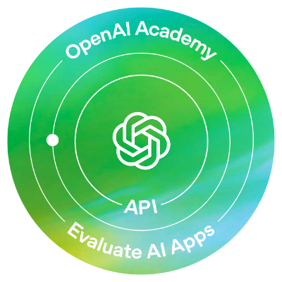

<p align="center">
  
</p>

# Evaluate AI Applications: Guided Lab

My completed guided lab for the OpenAI Academy **Evaluate AI Applications** course. It uses [Promptfoo](https://promptfoo.dev) to grade pre-written support answers with model-graded rubrics and a deterministic assertion.

[View credential](https://oaiacademy.credential.net/4d09a176-63a9-4aa0-9ca5-14b897d57267)

## What the lab covers

- Exploring the test cases and the structure of an eval.
- Configuring model-graded rubrics and a deterministic assertion.
- Running the eval and reviewing pass/fail results.
- Inspecting individual cases in the Promptfoo results viewer.

## Requirements

- Python 3.10+
- Node.js 24.x
- [Ollama](https://ollama.com) with the `gemma3:4b` model (the default grader runs locally)

## Setup

```bash
python3 -m venv .venv
source .venv/bin/activate
pip install -r requirements.txt
npm ci
ollama pull gemma3:4b
```

## Run

```bash
node scripts/promptfoo.mjs eval -c labs/lab01_evals_guided/promptfooconfig.yaml
node scripts/promptfoo.mjs view
```

To grade with an OpenAI model instead, change each rubric `provider` in `promptfooconfig.yaml` (for example, to `openai:chat:gpt-4o-mini`), copy `.env.example` to `.env`, and add your own API key. Never commit `.env`.

## Notes

- Some test cases are designed to fail. The point is to see how assertions and graders surface problems.
- Results vary between runs and grader models. See [KNOWN-ISSUES.md](KNOWN-ISSUES.md).
- Course material attribution: [ATTRIBUTION.md](ATTRIBUTION.md). License: [MIT](LICENSE).
